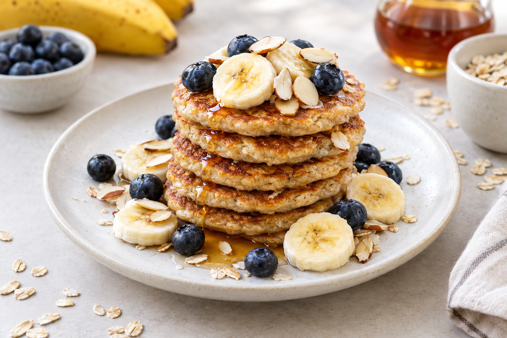

# Quick banana oatmeal pancakes

Gluten-free and dairy-free

Makes 6 to 8 pancakes

- Preparation: 5 minutes
- Cooking: 10 minutes

## Ingredients

- 90 g gluten-free rolled oats
- 2 large ripe bananas, sliced
- 1 large egg
- 1/2 teaspoon ground cinnamon
- 1 teaspoon honey, optional
- Neutral vegetable oil, for cooking

## Preparation

1. Place the rolled oats in a blender and blend until finely ground.
1. Add the bananas, egg, cinnamon and honey, then blend until the batter is smooth.
1. Heat a little vegetable oil in a frying pan over medium heat.
1. Once the pan is hot, pour in about 2 tablespoons of batter for each pancake. Cook on both sides until lightly golden.
1. Repeat with the remaining batter and serve warm.

## Serving suggestions

Serve with sliced banana, blueberries, maple syrup, flaked almonds, pecans or shredded coconut.

For a vegan version, replace the egg with 1 tablespoon of ground flaxseed mixed with 3 tablespoons of water. Let the mixture rest for 5 minutes before adding it to the batter. The pancakes will be higher in fibre, but more delicate to handle.

Source: [Quick oatmeal banana blender pancakes - Del's cooking twist](https://www.delscookingtwist.com/quick-oatmeal-banana-blender-pancakes/).
