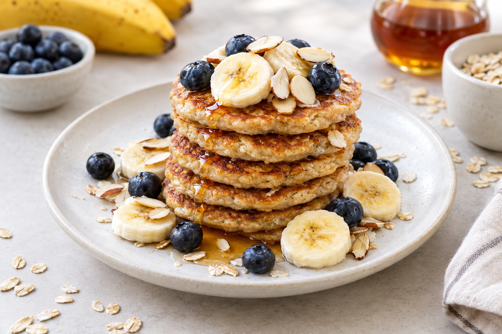

# Pancakes express banane et flocons d'avoine

Sans gluten et sans lactose

Pour 6 à 8 pancakes

- Préparation : 5 minutes
- Cuisson : 10 minutes

## Ingrédients

- 90 g de flocons d'avoine sans gluten
- 2 grosses bananes bien mûres, coupées en rondelles
- 1 gros œuf
- 1/2 cuillère à café de cannelle
- 1 cuillère à café de miel, facultatif
- Huile végétale neutre, pour la cuisson

## Préparation

1. Placer les flocons d'avoine dans un blender et les mixer jusqu'à obtenir une poudre fine.
1. Ajouter les bananes, l'œuf, la cannelle et le miel, puis mixer jusqu'à obtenir une pâte lisse et homogène.
1. Faire chauffer un peu d'huile végétale dans une poêle à feu moyen.
1. Lorsque la poêle est chaude, verser environ 2 cuillères à soupe de pâte par pancake. Faire cuire chaque face jusqu'à ce qu'elle soit légèrement dorée.
1. Répéter jusqu'à épuisement de la pâte et servir chaud.

## Suggestions

Servir avec des rondelles de banane, des myrtilles, du sirop d'érable, des amandes effilées, des noix de pécan ou de la noix de coco râpée.

Pour une version végétalienne, remplacer l'œuf par 1 cuillère à soupe de graines de lin moulues mélangée à 3 cuillères à soupe d'eau. Laisser reposer 5 minutes avant de l'ajouter à la pâte. Les pancakes seront plus riches en fibres, mais aussi plus fragiles à manipuler.

Source : [Pancakes express banane et flocons d'avoine - Del's cooking twist](https://www.delscookingtwist.com/fr/pancakes-express-banane-et-flocons-davoine-sans-gluten-sans-lactose/).
