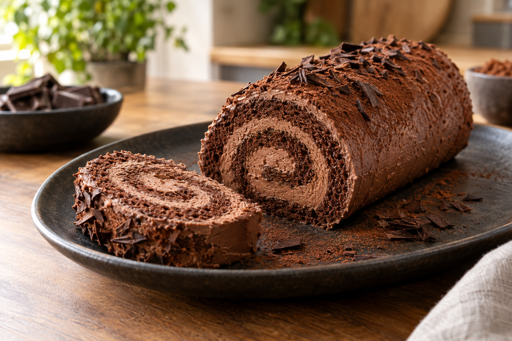

# Roulé suisse au double chocolat

Pour 8 personnes

- Préparation : 20 minutes
- Cuisson : 9 à 11 minutes
- Repos : 2 heures minimum

## Ingrédients

### Pour le biscuit au chocolat

- 4 gros œufs à température ambiante
- 125 g de sucre en poudre
- 1/2 cuillère à café d'extrait de vanille
- 1/4 cuillère à café de sel
- 45 ml d'huile de tournesol
- 71 g de farine de blé T45 ou T55
- 21 g de cacao en poudre non sucré, plus un peu pour saupoudrer
- 1/2 cuillère à café de levure chimique

### Pour la mousse au chocolat

- 260 ml de crème liquide entière à 35 % de matière grasse, bien froide
- 85 g de chocolat noir ou pâtissier à 50-55 % de cacao, finement haché

## Préparation

### Préparer le biscuit

1. Préchauffer le four à 175 °C en chaleur statique. Graisser légèrement une plaque à rebords d'environ 43 x 28 cm (ou 38 x 25 cm), puis la recouvrir de papier cuisson.
1. Battre les œufs pendant 3 minutes à vitesse moyenne-élevée. Ajouter progressivement le sucre, puis continuer à fouetter pendant 4 à 5 minutes. Le mélange doit presque tripler de volume, devenir pâle et épais, et former un ruban qui reste quelques instants à la surface.
1. Incorporer la vanille et le sel. Verser progressivement l'huile de tournesol tout en mélangeant doucement.
1. Tamiser ensemble la farine, le cacao et la levure chimique, puis tamiser une nouvelle fois ce mélange au-dessus des œufs. L'incorporer délicatement à la spatule, en deux fois, sans faire retomber la préparation.
1. Verser la pâte sur la plaque et l'étaler uniformément en couche fine. Enfourner pendant 9 à 11 minutes. Le biscuit est cuit lorsqu'il reprend sa forme après une légère pression du doigt. Ne pas prolonger la cuisson, au risque de le dessécher et de le faire fissurer.

### Rouler le biscuit

1. Laisser refroidir le biscuit pendant environ 1 minute, puis saupoudrer légèrement sa surface de cacao.
1. Détacher les bords avec un couteau et retourner le biscuit sur un torchon propre ou une nouvelle feuille de papier cuisson. Retirer délicatement le papier utilisé pour la cuisson.
1. Rouler immédiatement le biscuit encore chaud en intégrant le torchon dans le roulage. Le laisser refroidir complètement sous cette forme.

### Préparer la mousse au chocolat

1. Faire chauffer 80 ml de crème liquide jusqu'à frémissement. Retirer du feu, ajouter le chocolat et attendre 1 minute avant de mélanger jusqu'à obtenir une ganache lisse et brillante. La laisser refroidir pendant environ 5 minutes.
1. Monter les 180 ml de crème restants en chantilly ferme mais encore souple, pendant environ 2 à 4 minutes au batteur électrique. Arrêter dès que les pics tiennent et que les traces du fouet restent visibles.
1. Incorporer délicatement la ganache refroidie à la chantilly avec une spatule.

### Assembler le roulé

1. Dérouler délicatement le biscuit refroidi.
1. Répartir uniformément la mousse au chocolat en laissant environ 1 cm de marge sur les bords. Mettre un peu plus de garniture du côté qui formera le centre de la spirale.
1. Rouler de nouveau délicatement le gâteau, puis le déposer sur un plat avec la fermeture en dessous.
1. Couvrir et placer au réfrigérateur pendant au moins 2 heures. Saupoudrer légèrement de cacao avant de servir.

## Conseils

- Les œufs doivent être à température ambiante pour obtenir un maximum de volume.
- Ne pas remplacer l'huile par du beurre : elle permet au biscuit de rester souple après réfrigération.
- Rouler le biscuit lorsqu'il est encore chaud et éviter de trop le cuire pour limiter les fissures.
- Utiliser une crème liquide entière très froide. Une crème à 30 % de matière grasse peut convenir, mais la mousse sera un peu moins ferme.
- Ne pas fouetter la chantilly trop longtemps : elle deviendrait granuleuse, puis se transformerait en beurre.

Source adaptée : [Double Chocolate Swiss Roll Cake - Scientifically Sweet](https://scientificallysweet.com/double-chocolate-swiss-roll-cake/#recipe).
